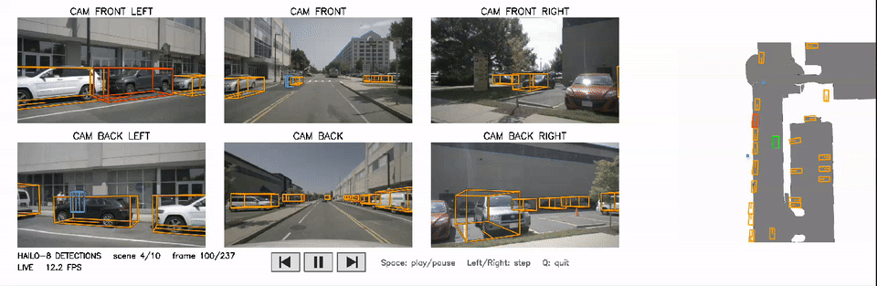

# BEV Demo


This demo uses a Hailo-8 device with PETRv2 to process 6 input images from nuScenes dataset.
It annotates these images with 3D bounding boxes and creates Bird's Eye View (BEV) representations.


<p xmlns:cc="http://creativecommons.org/ns#" xmlns:dct="http://purl.org/dc/terms/">
    <span property="dct:title">This gif uses images from <a href="https://www.nuscenes.org" target="_blank" rel="noopener noreferrer">nuScenes dataset</a>, and it</span> is licensed under
    <a href="https://creativecommons.org/licenses/by-nc-sa/4.0/?ref=chooser-v1" target="_blank" rel="license noopener noreferrer" style="display:inline-block;">CC BY-NC-SA 4.0
        
        
        
        
    </a>
</p>


Pipeline
--------


To more closely emulate a real application, run the demo with the 6 .jpg images from nuScenes.

When running the demo with raw data (.npy files) input, memory usage will be higher, as .npy files are loaded into RAM.
However, CPU usage will be lower because data loading does not occur in real time.


Requirements
------------

- hailo_platform==4.19.0
- Pyhailort


# Install the Demo - X86
-------------------------

1. Clone the repository:
    ```shell script
    git clone https://github.com/hailo-ai/hailo-BEV.git
            
    cd BEV_Demo
    ```

2. Install dependencies:

    We recommend running it within a virtual environment.
    ```shell script
    pip install -r requirements.txt
    ```

3. Download demo resources:
    ```shell script
    ./download_resources.sh
    ```

4. Data creation:
    
    Download the **Mini** version of the **Full dataset (v1.0)** of nuScenes from https://www.nuscenes.org/nuscenes#download (a free account is required).
    - **Note**: The download page also lists other datasets first, such as nuScenes-lidarseg, nuScenes-panoptic or nuImages. These only add annotations or contain other images, and do not work with this demo. Scroll down to **Full dataset (v1.0)** and download the **Mini** archive (``v1.0-mini.tgz``, about 5 GB once extracted).

    After extracting it, the dataset folder (the ``<path to nuScenes dataset>`` used below) should contain ``maps/``, ``samples/``, ``sweeps/`` and ``v1.0-mini/``.
    
    To run the demo with **.jpg** input, use:

    ```shell script
    ./src/common/prepare_data.py --data <path to nuScenes dataset>
    ```
    
    To run the demo with **raw data** input, use:

    ```shell script
    ./src/common/prepare_data.py --data <path to nuScenes dataset> --raw-data
    ```

    By default all the scenes of the dataset are prepared (10 scenes of about 20 s in v1.0-mini). To choose the scenes and their playback order, use ``--scenes`` with scene indices or names:

    ```shell script
    ./src/common/prepare_data.py --data <path to nuScenes dataset> --scenes 1 3 6 8
    ./src/common/prepare_data.py --data <path to nuScenes dataset> --scenes scene-0103 scene-1077
    ```
    With ``--raw-data``, each scene takes about 190 MB on disk. It is read from disk while the demo runs.

    By default, only the annotated keyframes are used (2 Hz, about 40 frames per scene). To use every camera frame instead (~12 Hz, including the unannotated sweeps between keyframes, about 230 frames per scene), add ``--sweeps``. The demo then plays the frames at the recorded pace, for smooth real-time video:

    ```shell script
    ./src/common/prepare_data.py --data <path to nuScenes dataset> --sweeps
    ```
    With ``--sweeps --raw-data``, each scene takes about 1.1 GB on disk. In ``--ground-truth`` mode, the boxes of the frames between keyframes are interpolated from the surrounding keyframes.

# Install the Demo - Embedded Architecture
------------------------------------------

1. Clone the repository both on the **host** and on the **platform**:
    ```shell script
    git clone https://github.com/hailo-ai/hailo-BEV.git
            
    cd BEV_Demo
    ```

2. Install dependencies both on the **host** and on the **platform**:

    We recommend running it within a virtual environment.
    ```shell script
    pip install -r requirements.txt
    ```

3. Download demo resources on the platform only:
    ```shell script
    ./download_resources.sh
    ```

4. Data creation:
    
    Download the **Mini** version of the **Full dataset (v1.0)** of nuScenes from https://www.nuscenes.org/nuscenes#download (a free account is required).
    - **Note**: The download page also lists other datasets first, such as nuScenes-lidarseg, nuScenes-panoptic or nuImages. These only add annotations or contain other images, and do not work with this demo. Scroll down to **Full dataset (v1.0)** and download the **Mini** archive (``v1.0-mini.tgz``, about 5 GB once extracted).

    After extracting it, the dataset folder (the ``<path to nuScenes dataset>`` used below) should contain ``maps/``, ``samples/``, ``sweeps/`` and ``v1.0-mini/``.
    
    **Execute this command on the **host** only:**
    
    To run the demo with **.jpg** input, use:

    ```shell script
    ./src/common/prepare_data.py --data <path to nuScenes dataset>
    ```
    
    To run the demo with **raw data** input, use:

    ```shell script
    ./src/common/prepare_data.py --data <path to nuScenes dataset> --raw-data
    ```

    By default all the scenes of the dataset are prepared (10 scenes of about 20 s in v1.0-mini). To choose the scenes and their playback order, use ``--scenes`` with scene indices or names:

    ```shell script
    ./src/common/prepare_data.py --data <path to nuScenes dataset> --scenes 1 3 6 8
    ./src/common/prepare_data.py --data <path to nuScenes dataset> --scenes scene-0103 scene-1077
    ```
    With ``--raw-data``, each scene takes about 190 MB on disk. It is read from disk while the demo runs.

    By default, only the annotated keyframes are used (2 Hz, about 40 frames per scene). To use every camera frame instead (~12 Hz, including the unannotated sweeps between keyframes, about 230 frames per scene), add ``--sweeps``. The demo then plays the frames at the recorded pace, for smooth real-time video:

    ```shell script
    ./src/common/prepare_data.py --data <path to nuScenes dataset> --sweeps
    ```
    With ``--sweeps --raw-data``, each scene takes about 1.1 GB on disk. In ``--ground-truth`` mode, the boxes of the frames between keyframes are interpolated from the surrounding keyframes.
    After running the command on the **host**, copy the /resources/input/ directory to the platform.
    - **Note**: The /resources/input/ folder must be present on both the host and the platform.

# Run Inference - X86
---------------------
To run inference, execute the following command from the repository's main folder:
```shell script
./src/x86/bev.py -d <data_path> --run-slow(optional)
```
For optimal visibility of 3D boxes, use the --run-slow flag. This will run the demo at 5 FPS. Since nuScenes samples were captured at 2 FPS, higher FPS values might obscure the 3D box display or create an illusion of faster vehicle movement.

**Arguments**

```shell script
./src/x86/bev.py -h
```

- ``-i, --input``: Path to the input folder, Use this flag only if you have modified the default input folder location.
- ``-m, --models``: Path to the models folder, Use this flag only if you have modified the default model folder location.
- ``-d, --data``: Path to the data folder, where the nuScenes dataset is.
- ``--run-slow``: Run the demo at 5 FPS for better visualization of 3D boxes.
- ``--raw-data``: Run the demo from raw data for lower cpu usage.
- ``--score-threshold``: Hide detections with a lower confidence score (default 0.45, use 0 to show all).
- ``--ground-truth``: Show the nuScenes ground-truth boxes instead of the Hailo detections. Does not use the Hailo device.
- ``--prev-frame-gap``: Time between the current frame and the earlier frame the model uses with it, in seconds (default 0.25). With keyframes, the previous keyframe (0.5 s earlier) is always used.
- ``--no-tracker``: Show the detections of each frame as they are. By default, the objects are tracked across frames (3D tracker in the style of ByteTrack) for steadier boxes: with ``--sweeps`` data, boxes flicker about 80% less and jitter about 65% less, at the same precision; with keyframes only, the gain is smaller.


**Example**

```shell script
./src/x86/bev.py --run-slow
```
*Press Ctrl-C to stop the demo.*

**Window controls**

- ``Space`` or the middle button: pause / resume.
- ``Left`` / ``Right`` arrows or the side buttons: pause and step one frame back / forward. The last 300 frames are kept; stepping forward past the newest frame waits for the next one from the pipeline. Resuming replays the frames you stepped back over, then continues live.
- ``Q``, ``Esc`` or closing the window: stop the demo.

The arrows in the window toolbar are OpenCV's pan buttons (they only move the view when zoomed in), not playback controls.

**Comparing with the ground truth**

Run a second instance with ``--ground-truth`` next to a Hailo instance. It shows the annotated boxes of the same frames, filtered like the detections (the 10 detection classes, the same range per class, and only objects seen by the lidar or radar). Each window shows its source and the scene and frame number, which you can line up with the playback controls:
```shell script
./src/x86/bev.py -d <data_path> --run-slow
./src/x86/bev.py -d <data_path> --run-slow --ground-truth
```

# Run Inference - Embedded Architecture
-----------------------------------------

Platform side
-------------

To run inference, execute the following command from the repository's main folder:
```shell script
./src/embedded/platform/bev.py -d <data_path> --set-ip <platform ip> --set-port <communication port>(optional) --run-slow(optional)
```
For optimal visibility of 3D boxes, use the --run-slow flag. This will run the demo at 5 FPS. Since nuScenes samples were captured at 2 FPS, higher FPS values might obscure the 3D box display or create an illusion of faster vehicle movement.


**Arguments**

```shell script
./src/embedded/platform/bev.py -h
```

- ``-i, --input``: Path to the input folder, Use this flag only if you have modified the default input folder location.
- ``-m, --models``: Path to the models folder, Use this flag only if you have modified the default model folder location.
- ``-d, --data``: Path to the data folder, where the nuScenes dataset is.
- ``--run-slow``: Makes the demo run in 5 FPS.
- ``--jpg-input``: Run the demo using .jpg data input, may require more CPU power.
- ``--set-ip``: Set platform's ip.
- ``--set-port``: Change the port from 5555 to another one.
- ``--score-threshold``: Hide detections with a lower confidence score (default 0.45, use 0 to show all).
- ``--prev-frame-gap``: Time between the current frame and the earlier frame the model uses with it, in seconds (default 0.25). With keyframes, the previous keyframe (0.5 s earlier) is always used.
- ``--no-tracker``: Show the detections of each frame as they are. By default, the objects are tracked across frames (3D tracker in the style of ByteTrack) for steadier boxes: with ``--sweeps`` data, boxes flicker about 80% less and jitter about 65% less, at the same precision; with keyframes only, the gain is smaller.

**Example**

```shell script
./src/embedded/platform/bev.py --set-ip <platform ip> --run-slow 
```
*Press Ctrl-C on the host side only to stop the demo.*

Host side 
----------
Run the Host side only after you see "Listening on {ip}:{port}" on the platform side.

Run visualization: 
```shell script
./src/embedded/host/viz.py -d <data_path> --set-ip <platform ip> --set-port <communication port>(optional)
```

**Arguments**
```shell script
./src/embedded/host/bev.py -h
```

- ``-d, --data``: Path to the data folder, where the nuScenes dataset is.
- ``-i, --input``: Path to the input folder, Use this flag only if you have modified the default input folder location.
- ``--set-ip``: Set platform's ip.
- ``--set-port``: Change the port from 5555 to another one.


**Example**

```shell script
./src/embedded/host/bev.py --set-ip <platform ip>
```
*Press Ctrl-C to stop the demo.*

**Window controls**

- ``Space`` or the middle button: pause / resume.
- ``Left`` / ``Right`` arrows or the side buttons: pause and step one frame back / forward. The last 300 frames are kept; stepping forward past the newest frame waits for the next one from the pipeline. Resuming replays the frames you stepped back over, then continues live.
- ``Q``, ``Esc`` or closing the window: stop the demo.

The arrows in the window toolbar are OpenCV's pan buttons (they only move the view when zoomed in), not playback controls.


Additional Notes
----------------
- Ran the demo on: Dell PC (Model: Latitude 5431), with CPU (Model: 12th Gen Intel(R) Core(TM) i7-1270P).
- Running the demo at 12 FPS loads the Hailo-8 at about 70% utilization, with an average power consumption of 2 W. To measure it:
    1. In a first terminal, enable the HailoRT monitor and run the demo:
        ```shell script
        export HAILO_MONITOR=1
        ./src/x86/bev.py -d <data_path>
        ```
    2. In a second terminal, show the utilization of the Hailo-8:
        ```shell script
        hailortcli monitor
        ```
    3. In a third terminal, measure the average power consumption over 30 seconds:
        ```shell script
        hailortcli measure-power --duration 30
        ```
- The demo's frame rate is limited by the computation on the CPU (image decoding, post-processing and visualization), not by the Hailo-8, so results may vary depending on the host system.
- To measure the raw performance of the Hailo-8 alone, use ``hailortcli run2``. For example, on a system with a 2-lane PCIe Gen 3 link, the maximum is 16 FPS at 2 W, obtained by running from the ``resources/models/`` folder:
    ```shell script
    hailortcli run2 --measure-power -t 30 set-net petrv2_repvggB0_backbone_pp_800x320.hef --framerate 98 --scheduler-priority 16 set-net petrv2_repvggB0_transformer_pp_800x320.hef --framerate 16 --scheduler-priority 15
    ```
    The Hailo-8 utilization was already at 95% for this measurement, so a host system with a 4-lane PCIe link would not improve it much.
- All data is computed at runtime, except of the map, which is derived from the ground truth.

License
----------
The BEV Demo is released under the MIT license. Please see the https://github.com/hailo-ai/hailo-BEV/blob/main/LICENSE file for more information.


Disclaimer
----------
This code demo is provided by Hailo solely on an “AS IS” basis and “with all faults”. No responsibility or liability is accepted or shall be imposed upon Hailo regarding the accuracy, merchantability, completeness or suitability of the code demo. Hailo shall not have any liability or responsibility for errors or omissions in, or any business decisions made by you in reliance on this code demo or any part of it. If an error occurs when running this demo, please open a ticket in the "Issues" tab.

This demo was tested on specific versions and we can only guarantee the expected results using the exact version mentioned above on the exact environment. The demo might work for other versions, other environment or other HEF file, but there is no guarantee that it will.